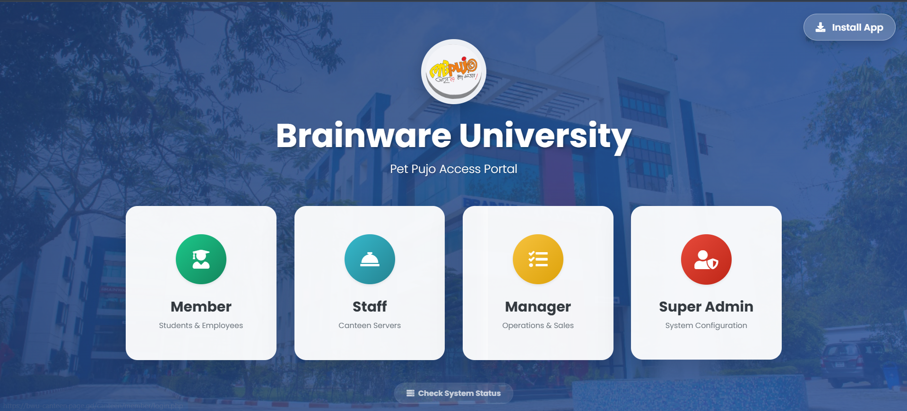
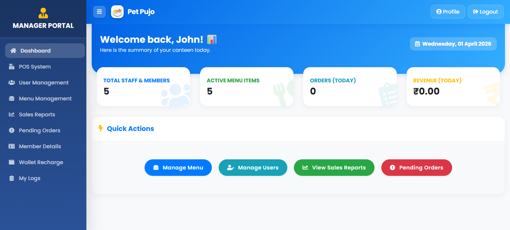
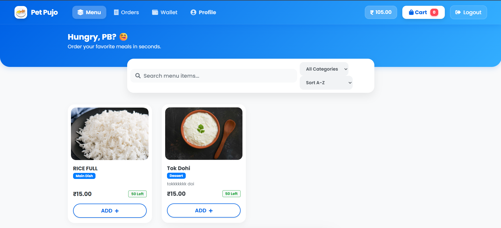
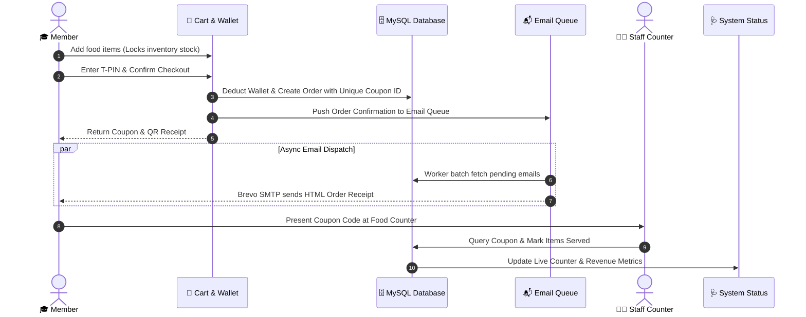

# 🍽️ Pet Pujo — Smart Campus Canteen Management System

<div align="center">

  

  <h3>Enterprise Multi-Portal Canteen Automation & Digital Wallet Platform</h3>
  <p>A fast, secure, progressive web application designed for campus cafeterias, enterprise food courts, and university dining halls.</p>

  <p>
    <a href="#-quick-start"></a>
    <a href="#-database-schema"></a>
    <a href="#-mailer-architecture"></a>
    <a href="#-progressive-web-app"></a>
    <a href="#-security--best-practices"></a>
    <a href="#-license"></a>
  </p>

  <p>
    <a href="#-interactive-showcase"><b>Explore Showcase</b></a> •
    <a href="#-key-features"><b>Key Features</b></a> •
    <a href="#-role-based-portals"><b>Role Portals</b></a> •
    <a href="#-quick-start"><b>Quick Start</b></a> •
    <a href="#-default-demo-credentials"><b>Demo Logins</b></a> •
    <a href="#-system-architecture"><b>Architecture</b></a>
  </p>

</div>

---

## 📌 Table of Contents
- [✨ Highlights](#-highlights)
- [📸 Interactive Showcase](#-interactive-showcase)
- [🚀 Key Features](#-key-features)
- [👥 Role-Based Portals](#-role-based-portals)
- [🏗️ System Architecture & Workflow](#️-system-architecture--workflow)
- [⚡ Quick Start Guide](#-quick-start-guide)
- [🔑 Default Demo Credentials](#-default-demo-credentials)
- [🔐 Security & API Key Protection](#-security--api-key-protection)
- [📂 Project Directory Structure](#-project-directory-structure)
- [🩺 System Health Diagnostics](#-system-health-diagnostics)
- [🤝 Contributing & License](#-contributing--license)

---

## ✨ Highlights

- **4 Dedicated Portals**: Individual, secure portals for **Super Admin**, **Managers**, **Kitchen Staff**, and **Students/Members**.
- **Digital Wallet & T-PIN Protection**: Real-time wallet balance, instant top-up via POS cash desk, and dual-layer T-PIN authentication.
- **Dynamic Coupon Token System**: Unique alphanumeric coupon generation per order with itemized fulfillment verification.
- **Asynchronous Transactional Emails**: Non-blocking email queue worker utilizing **PHPMailer** and **Brevo SMTP API** for order receipts and activation emails.
- **PWA Enabled**: Installable on Android, iOS, and Desktop with offline fallback screens and asset caching.
- **Live System Health Monitor**: Built-in dashboard (`system_status.php`) tracking database ping, server memory, CPU load, and real-time revenue metrics.

---

## 📸 Interactive Showcase

<div align="center">

| 🚪 Role Selection Gateway | 📊 Real-Time Operations Dashboard |
| :---: | :---: |
|  |  |

| 🍔 Live Digital Food Menu & Cart Reservation |
| :---: |
|  |

</div>

---

## 🚀 Key Features

### 🎓 1. Member & Student Experience
- **Self Activation & Login**: Clean onboarding with email verification and unique Member ID.
- **Real-Time Food Reservations**: Timed cart reservations that prevent race conditions and lock inventory temporarily during checkout.
- **Digital Cashless Wallet**: Instant order debits, recharge balance history, and complete credit/debit audit logs.
- **Dynamic Coupons**: Generated coupons with printable receipts and visual status tags (`pending`, `fully_served`, `partially_served`, `refunded`).

### 👨‍🍳 2. Fast-Track Staff Counter
- **Rapid Coupon Verification**: Kitchen counter operators quickly lookup order coupons by ID.
- **Partial & Full Item Serving**: Mark individual food items as served with serving timestamp logs.
- **Shift Serving History**: Complete audit trail of items fulfilled by counter personnel.

### 💼 3. Manager Operations & POS Desk
- **Point of Sale (POS) Terminal**: Direct over-the-counter ordering and billing for walk-in users.
- **Cash Top-Up Desk**: Credit member wallets instantly with cash receipts.
- **Stock & Menu Control**: Toggle item active/inactive status, update prices, and set automated daily stock resets.
- **Unserved Order Refunds**: Automated wallet refunds for cancelled or unserved menu items.
- **Sales Analytics**: Filterable revenue reports by date range and category.

### 👑 4. Super Administrator Suite
- **Role-Based Access Control (RBAC)**: Create, deactivate, and manage Managers, Staff, and Members.
- **Institutional Branding**: Customize institution name, canteen logo, address, and banner assets.
- **Audit Logs & Master Settings**: Global oversight of system transactions, orders, and configuration.

### ⚡ 5. High-Performance Email Queue
- Orders and account activations are queued in the `email_queue` table.
- Dispatched asynchronously in background worker batches (`process_email_queue.php`) via **Brevo SMTP (PHPMailer)**.
- Closes the HTTP connection immediately so the end user experiences **instant UI response without network latency**.

---

## 👥 Role-Based Portals

```
                    ┌─────────────────────────┐
                    │    index.php (Gateway)   │
                    └────────────┬────────────┘
                                 │
     ┌───────────────────┬───────┴───────────┬───────────────────┐
     ▼                   ▼                   ▼                   ▼
┌──────────────┐  ┌──────────────┐   ┌──────────────┐   ┌──────────────┐
│ Member Portal│  │ Staff Portal │   │Manager Portal│   │  Super Admin │
│  (/member)   │  │   (/staff)   │   │  (/manager)  │   │(/super_admin)│
└──────────────┘  └──────────────┘   └──────────────┘   └──────────────┘
```

| Portal | URL Path | Key Responsibilities |
| :--- | :--- | :--- |
| **Member** | `/member/login.php` | Browse menu, reserve cart, place orders, wallet balance, profile & T-PIN |
| **Staff** | `/staff/login.php` | Fast coupon lookup, food item serving verification, serving history |
| **Manager** | `/manager/login.php` | POS billing counter, member wallet recharge, menu inventory, refunds |
| **Super Admin** | `/super_admin/login.php` | Institutional settings, branding, RBAC user management, sales reports |

---

## 🏗️ System Architecture & Workflow



---

## ⚡ Quick Start Guide

### 📋 Prerequisites
- **Web Server**: Apache / Nginx (XAMPP, WAMP, Laragon, or Linux LAMP)
- **PHP**: `8.0` or higher (with `pdo_mysql`, `curl`, `mbstring`, `openssl` extensions enabled)
- **Database**: MySQL `5.7+` or MariaDB `10.3+`
- **SMTP Provider**: Brevo (Sendinblue) or any standard SMTP service for transactional emails

---

### 🔧 Step-by-Step Installation

#### 1. Clone the Repository
```bash
git clone https://github.com/your-username/canteen-management-system.git
cd canteen-management-system
```

#### 2. Create the Database & Import Schema
1. Open **phpMyAdmin** (or MySQL CLI):
   ```sql
   CREATE DATABASE canteen_db CHARACTER SET utf8mb4 COLLATE utf8mb4_unicode_ci;
   ```
2. Import the clean, pre-configured schema file:
   - Import [`database/schema.sql`](database/schema.sql) into `canteen_db`.
   > [!TIP]
   > `database/schema.sql` comes with all essential tables, default branding settings, sample menu items, and clean demo accounts ready for testing!

#### 3. Configure Database Credentials
Copy the database configuration template to `includes/db.php`:
```bash
# On Windows PowerShell:
Copy-Item includes/db.example.php includes/db.php

# On Linux / macOS:
cp includes/db.example.php includes/db.php
```

Open [`includes/db.php`](includes/db.php) and update your database credentials:
```php
define('DB_SERVER', 'localhost');
define('DB_USERNAME', 'root');
define('DB_PASSWORD', 'your_mysql_password');
define('DB_NAME', 'canteen_db');
```

#### 4. Configure Brevo SMTP / PHPMailer Credentials
Copy the mailer configuration template to `includes/mailer.php`:
```bash
# On Windows PowerShell:
Copy-Item includes/mailer.example.php includes/mailer.php

# On Linux / macOS:
cp includes/mailer.example.php includes/mailer.php
```

Open [`includes/mailer.php`](includes/mailer.php) and insert your SMTP credentials:
```php
$mail->Host       = 'smtp-relay.brevo.com';
$mail->Username   = 'your_brevo_smtp_login';
$mail->Password   = 'xsmtpsib-your_brevo_smtp_key';
$mail->setFrom('your_verified_sender@example.com', 'Canteen System');
```

#### 5. Launch Application
Place the project directory inside your web root (e.g. `htdocs/canteen` for XAMPP):
- Access the portal at: `http://localhost/canteen/`
- Access system status at: `http://localhost/canteen/system_status.php`

---

## 🔑 Default Demo Credentials

Once [`database/schema.sql`](database/schema.sql) is imported, use these ready-to-test credentials:

| Role | Username / ID | Password | Default T-PIN | Login URL |
| :--- | :--- | :--- | :--- | :--- |
| **👑 Super Admin** | `SA001` | `password` | — | [`/super_admin/login.php`](super_admin/login.php) |
| **💼 Manager** | `EMP01` | `password` | `1234` | [`/manager/login.php`](manager/login.php) |
| **👨‍🍳 Canteen Staff** | `STF001` | `password` | — | [`/staff/login.php`](staff/login.php) |
| **🎓 Demo Member** | `1001` | `password` | `1234` | [`/member/login.php`](member/login.php) |

> [!IMPORTANT]
> Change all default passwords and secret keys immediately before deploying to a production server!

---

## 🔐 Security & API Key Protection

This repository strictly adheres to senior developer security standards:

<details>
<summary><b>🛡️ Click to view Security Hardening Details</b></summary>

1. **Zero Secret Leakage via `.gitignore`**:
   - Live files containing API keys and database credentials (`includes/db.php`, `includes/mailer.php`, `.env`) are **strictly excluded** by [`.gitignore`](.gitignore).
   - Safe sample templates ([`includes/db.example.php`](includes/db.example.php), [`includes/mailer.example.php`](includes/mailer.example.php), [`.env.example`](.env.example)) are provided for seamless open-source onboarding.
2. **Database Privacy**:
   - Production database dumps containing user personal emails or session tokens are ignored.
   - Clean, sanitized [`database/schema.sql`](database/schema.sql) is tracked instead.
3. **Prepared Statements**:
   - 100% of SQL queries utilize PDO prepared statements with strict parameter binding to eliminate SQL Injection (SQLi) risks.
4. **Dual-Layer T-PIN Verification**:
   - Critical member transactions (wallet debits) and manager actions require a 4-digit T-PIN confirmation.
5. **Apache Access Restrictions**:
   - Direct HTTP access to sensitive config files, logs, and includes is rejected via custom server access rules.

</details>

---

## 📂 Project Directory Structure

```plaintext
canteen/
├── assets/                  # Frontend assets
│   ├── css/                 # Global styles & responsive UI sheets
│   ├── js/                  # Client-side validation & UI scripts
│   └── images/              # Logos, meal photos & dashboard screenshots
├── database/                # Database migrations & schemas
│   ├── schema.sql           # Clean, sanitized database setup script
│   └── canteen.sql          # (Gitignored) Raw development database dump
├── error/                   # Custom HTTP error handlers (400, 401, 403, 404, 500, 503)
├── includes/                # Backend core modules & database configs
│   ├── db.example.php       # Safe template for MySQL PDO database connection
│   ├── db.php               # (Gitignored) Live database credentials
│   ├── mailer.example.php   # Safe template for Brevo SMTP / PHPMailer
│   ├── mailer.php           # (Gitignored) Live Brevo SMTP credentials
│   ├── check_session.php    # Role-based session gatekeeper
│   ├── resolve_session.php  # Multi-portal session disambiguation
│   └── process_email_queue.php # Background async transactional email processor
├── libs/                    # Third-party vendor libraries
│   └── PHPMailer/           # Standalone PHPMailer library
├── manager/                 # Manager Portal (POS, Recharges, Menu Management, Reports)
├── member/                  # Member Portal (Ordering, Cart, Wallet, Dynamic Coupons)
├── staff/                   # Kitchen Staff Portal (Fast Coupon Claim & Food Serving)
├── super_admin/             # Super Admin Portal (RBAC, System Settings, Audit Logs)
├── .env.example             # Safe environment variable configuration template
├── .gitignore               # Comprehensive exclusion rules for secrets & logs
├── htaccess                 # Apache server hardening & security headers
├── index.php                # Unified role selection gateway
├── manifest.json            # PWA Web App Manifest
├── offline.php              # PWA Offline fallback page
├── sw.js                    # PWA Service Worker for offline asset caching
├── system_status.php        # Live system health diagnostic dashboard
└── README.md                # Project documentation
```

---

## 🩺 System Health Diagnostics

The platform includes an internal real-time health dashboard at [`system_status.php`](system_status.php):

<details>
<summary><b>📊 Click to view Health Metrics Monitored</b></summary>

- **Database Ping**: Measures round-trip PDO latency in milliseconds.
- **Server Load**: Multi-core load averages (1m, 5m, 15m).
- **Memory & Disk**: Real-time memory allocation and disk volume consumption.
- **Live Business KPIs**:
  - Today's completed orders
  - Today's total gross revenue
  - Real-time pending kitchen orders
  - Total active campus members

</details>

---

## 🤝 Contributing & License

Contributions, issues, and feature requests are welcome!

1. Fork the Project
2. Create your Feature Branch (`git checkout -b feature/AmazingFeature`)
3. Commit your Changes (`git commit -m 'Add some AmazingFeature'`)
4. Push to the Branch (`git push origin feature/AmazingFeature`)
5. Open a Pull Request

Distributed under the **MIT License**. See `LICENSE` for more information.

---

<div align="center">
  <sub>Built with ❤️ for Campus Dining Communities.</sub>
</div>
